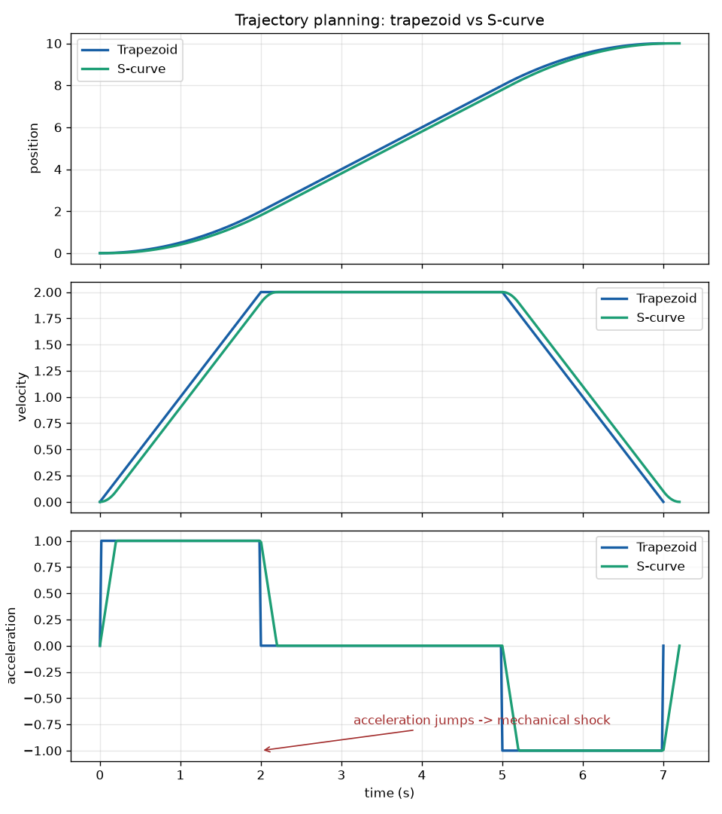

# 轨迹规划：梯形与 S 型速度曲线

给定起点、终点和电机的物理极限（最大速度 `vmax`、最大加速度 `amax`，
S 曲线再加最大加加速度 `jmax`），生成一条**每个时刻的位置、速度、加速度
都确定且平滑**的运动曲线，供 PID 跟踪。

```
pip install -r requirements.txt
python trajectory.py     # 自检：10 组边界条件全部验证
python plot_demo.py      # 生成 result.png：梯形 vs S 曲线对比图
```

## 为什么需要它

电机有物理极限。直接"全速冲过去再急刹"会过冲、抖动、伤机械结构。
规划器先算出"什么时刻该在哪、跑多快"，PID 再负责跟踪这条曲线——
"规划器 + PID"是机器人运动控制的标准架构。

## 用法

```python
from trajectory import TrapezoidalProfile, SCurveProfile

# 从 0 走到 10，限速 2、限加速度 1、限 jerk 5
prof = SCurveProfile(q0=0, q1=10, vmax=2, amax=1, jmax=5)

for t in [0.0, prof.T / 2, prof.T]:
    q, v, a = prof.sample(t)      # 该时刻的位置、速度、加速度

print(prof.T)                     # 走完全程需要的总时间
```

`sample(t)` 对超出 `[0, T]` 的时间自动做截断，起点和终点严格满足
`v = 0, a = 0`（从静止开始，到静止结束）。

## 两种速度曲线

| | 梯形曲线 `TrapezoidalProfile` | S 型曲线 `SCurveProfile` |
|---|---|---|
| 加速度 | 有突变，起步/刹停有冲击 | 平滑变化，jerk 受限 |
| 段数 | 3 段（加速/匀速/减速） | 7 段（jerk 正负交替 + 匀速） |
| 实现难度 | 简单，单片机常用 | 稍复杂，高级伺服常用 |
| 适用 | 要求不高的场合 | 怕抖、怕冲击、怕伤结构的场合 |

`result.png`（由 `plot_demo.py` 生成）把两条曲线的位置、速度、加速度
画在一起：梯形曲线的加速度是跳变的方波，S 曲线则全程光滑——
代价是达到同样的峰值速度需要更长时间。



## 技术要点

- **梯形曲线**：加速距离 `vmax²/(2·amax)`，两端加速段放得下就是梯形，
  放不下自动退化为三角形（短距离模式），峰值速度按距离重新折算；
- **S 曲线（七段式）**：jerk 正向 → 匀加速 → jerk 负向 → 匀速 →
  镜像减速五段对称展开，通过对 jerk 分段积分得到速度和位置。
  短距离时用二分搜索寻找可行的峰值速度，保证 jerk 约束不被突破；
- **物理量的层次关系**：位置 →（求导）→ 速度 →（求导）→ 加速度 →
  （求导）→ jerk。规划的本质就是逐层积分回去；
- **反向运动**：`q1 < q0` 时自动按负方向规划，各物理量符号自洽。

## 验证情况

`python trajectory.py` 会跑一组自检，覆盖：

| 场景 | 验证内容 |
|---|---|
| 常规距离 | 终点位置精确、起止速度/加速度为零 |
| 短距离 | 自动降速为三角形 / 二分搜索可行峰值，终点依然精确 |
| 反向运动 | `q1 < q0` 时位置单调递减、约束不破 |
| 零距离 | 起点即终点，不除零、不报错 |
| 极小 jerk | `jmax` 很小时七段式退化为近似梯形，约束仍满足 |
| 密集采样 | 2000 个采样点上速度、加速度全程不越界 |

## 文件说明

| 文件 | 内容 |
|---|---|
| `trajectory.py` | 两个规划器类 + 自检入口（直接运行即验证） |
| `plot_demo.py` | 采样两条曲线并绘制三联对比图，输出 `result.png` |
| `result.png` | 预生成的对比图 |

## 适用边界

- 单轴标量规划（一个位置量），多轴联动需要每个轴各跑一个实例；
- 不含路径形状（避障、曲线路径）——那是路径规划层的事，
  本程序负责"沿已知路径怎么走"；
- 纯 Python/numpy 实现，单片机上迁移为 C 时代码结构可以直接照搬。
